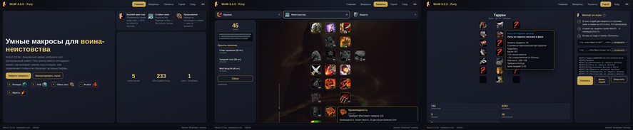
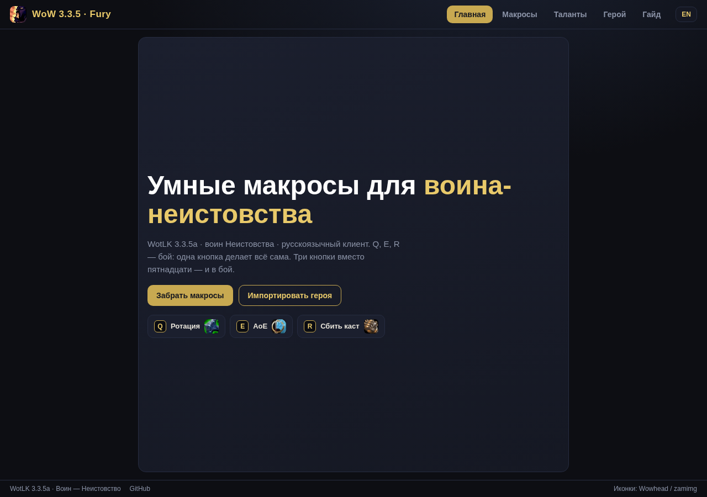
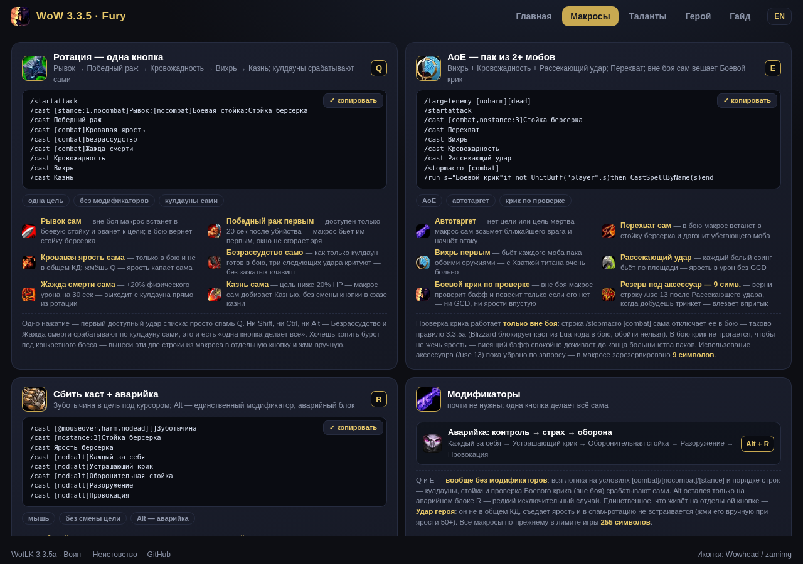
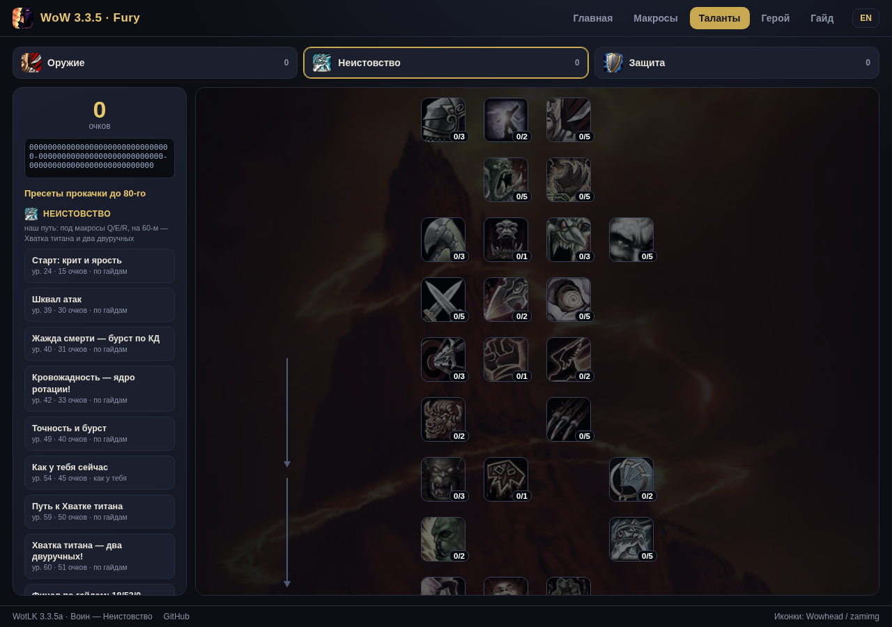
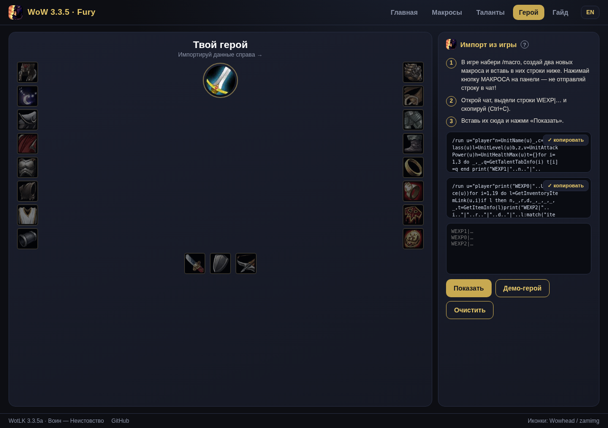
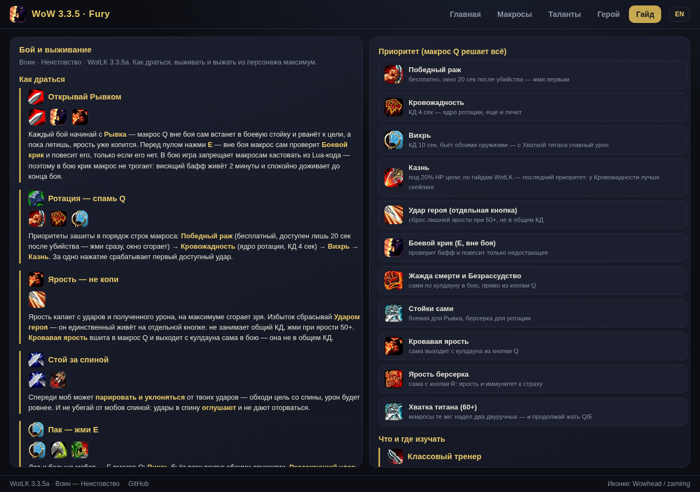

<div align="center">



# WoW 3.3.5 · Smart Fury Warrior Macros

**Three buttons instead of fifteen: one button does it all — each macro picks
the right ability for the situation, swaps stances by itself, fires cooldowns
by itself and keeps Battle Shout checked. Plus an app-like site: an in-game
style talent viewer, addon-free hero import and a combat & survival guide.**

[](https://genocide12.github.io/wow-335-macros/)
[](https://github.com/Genocide12/wow-335-macros/releases)
[](macros/warrior-smart/en/)
[](LICENSE)

**[▶ OPEN THE SITE](https://genocide12.github.io/wow-335-macros/?lang=en)** ·
**[Macros](https://genocide12.github.io/wow-335-macros/macros.html?lang=en)** ·
**[Talents](https://genocide12.github.io/wow-335-macros/talents.html?lang=en)** ·
**[Hero](https://genocide12.github.io/wow-335-macros/hero.html?lang=en)** ·
**[Guide](https://genocide12.github.io/wow-335-macros/guide.html?lang=en)**

**По-русски? → [README.md](README.md)**

</div>

---

## What is this

A set of **3 combat macros** for a Fury warrior on WotLK 3.3.5a.
**No Shift, no Ctrl — Alt survives in exactly one place**, the panic block of
button R. Everything else the button does on its own:

* rotation priorities are baked into the `/cast` order — one press fires the
  first available ability;
* stances swap via `[stance]` conditions, combat state via `[combat]`;
* **cooldowns fire themselves**: Bloodrage, Recklessness and Death Wish go off
  in combat the moment they are ready — no keys to hold;
* **long buffs — only when checked**: out of combat macro E checks
  **Battle Shout** and applies it only if missing — no GCD or rage wasted.

Why the check only works out of combat: in combat 3.3.5a **forbids** casting
from Lua code (`/run` + `CastSpellByName` — the game says “this action is only
available to the Blizzard UI”), and macros have no native `[buff:]`
conditions. The `/stopmacro [combat]` line in E disables the check in combat
by itself — fully legal. An applied shout lasts 2 minutes and comfortably
outlasts most fights.

Every macro fits the game's **255-character limit**.

```
Q → rotation (single target): Charge, cooldowns, Bloodthirst → Whirlwind → Execute
E → AoE (2+ mobs): auto-target, Intercept, Whirlwind → Bloodthirst → Cleave
R → interrupt (mouseover) + Alt — the panic block
```

| Button | What it does on its own |
|---|---|
| **Q** | out of combat — Battle Stance + Charge; in combat — Berserker Stance; Victory Rush → Bloodthirst → Whirlwind → Execute; Bloodrage, Recklessness and Death Wish fire themselves off cooldown |
| **E** | auto target swap; in combat — Intercept + Berserker Stance; Whirlwind → Bloodthirst → Cleave; out of combat — checked Battle Shout |
| **R** | Pummel into the mob **under the cursor** — no target switch; Berserker Stance itself; Berserker Rage itself off cooldown |
| **Alt+R** | the only modifier — panic cascade: Every Man for Himself → Intimidating Shout → Defensive Stance → Disarm → Taunt (several presses in a row) |

Only **Heroic Strike** lives on its own button: it sits off the GCD, eats rage
and does not fit a spam rotation — bind it separately and press it above 50
rage. **9 characters** are reserved in macro E for a trinket — the line
`/use 13` comes back with a single insert once you get one.

## How the smart macros work

3.3.5 mechanics: one press fires the **first available** ability of the list,
so the line order is the priority order. Spam Q and the rotation plays itself,
cooldowns go off the moment they are ready. Press E between packs and Battle
Shout is always up. R is your interrupt, your anti-fear and your panic button.

> **Client language matters.** A 3.3.5 macro only understands ability names in
> the client's language. `ru/` — Russian client, `en/` — English. The Russian
> names are verified against the real 3.3.5a client DB (wowroad.info): talent
> 12292 is “Жажда смерти” (WotLK Classic renamed it — not your client).

## Install (1 minute)

1. Download `macros-cache-en.txt` from the
   [latest release](https://github.com/Genocide12/wow-335-macros/releases)
   (Russian client: `macros-cache-ru.txt`).
2. Close the game. Put the file into `WTF/Account/<name>/macros-cache.txt`
   (back up the old file — it gets overwritten).
3. Log in, `/macro` → "General" tab — all macros are there.
   Bind them to Q, E, R.

Or simply copy each macro's text with the ✓ button on the
[macros page](https://genocide12.github.io/wow-335-macros/macros.html?lang=en)
and paste it into new in-game macros.

## The site — like an app

Five screens, each fits **without scrolling** on desktop and mobile:

| Home | Macros |
|:---:|:---:|
|  |  |

| Talents (builds) | Hero (import) | Guide |
|:---:|:---:|:---:|
|  |  |  |

* **Macros** — cards with real ability icons, one-click copy and each macro's
  features right in the card.
* **Talents** — every warrior talent in three trees, like in game: icons, ranks,
  dependency arrows, requirement checks. Click — add a point, Shift+click — remove.
  **Leveling presets to 80 for all three trees**: Fury (the road to Titan's Grip
  at 60), Arms and Protection — per the top guides (Wowhead / Icy Veins /
  Warcraft Tavern) plus my own DPS and survival builds, and "your current".
* **Hero** — **addon-free** character import: two short `/run` macros print a
  `WEXP|…` line into chat (paste the line into a macro and press the macro
  button — do not send it to chat); paste the lines on the site and you get a
  paperdoll with real item icons and live Wowhead tooltips.
* **Guide** — how to fight and survive: rotation, rage management, positioning,
  survival and what to learn where to squeeze the maximum out of your character.
  A dedicated **Titan's Grip (60+)** section: two two-handed swords or axes,
  the −10% physical damage penalty and why it is still top, stats, and what
  changes in the rotation (spoiler: the macros stay the same).

## Releases

Every notable macro change is published as a
[release](https://github.com/Genocide12/wow-335-macros/releases) —
`macros-cache-ru.txt` and `macros-cache-en.txt` are attached to each release,
so you can download and drop them into the game without cloning the repo.

## Structure

```
docs/               site (GitHub Pages)
  index.html        home
  macros.html       macros: icons, copy, features, modifiers
  talents.html      talent viewer (3 trees, presets)
  hero.html         in-game hero import (WEXP), paperdoll, Wowhead tooltips
  guide.html        guide: combat, survival, Titan's Grip, what & where to learn
  assets/js/macros-data.js  macro texts (embedded, no fetch)
  assets/           tree backgrounds, talent data, logo (icons come from the Wowhead CDN)
macros/warrior-smart/{ru,en}/   3 combat + 2 export, RU and EN clients
install/macros-cache-{ru,en}.txt  one-file install (attached to releases)
```

Ability and item icons are loaded straight from the Wowhead CDN (zamimg) —
nothing is stored in the repo. Live item tooltips are fetched from Wowhead
on the fly.

## License

[MIT](LICENSE). Icons and data — © Blizzard Entertainment, collected via the
open Wowhead/zamimg APIs.
