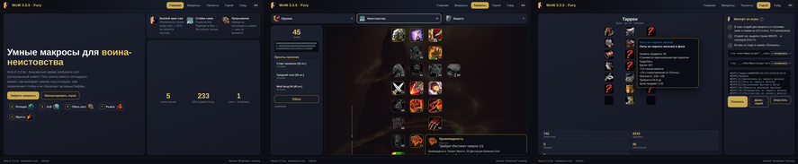
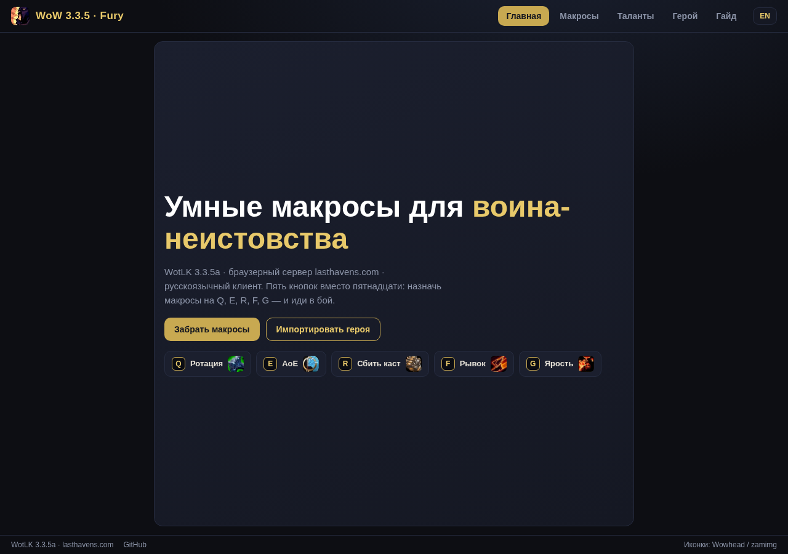
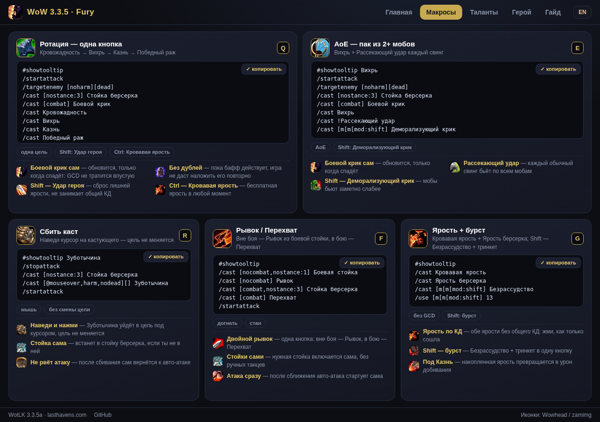
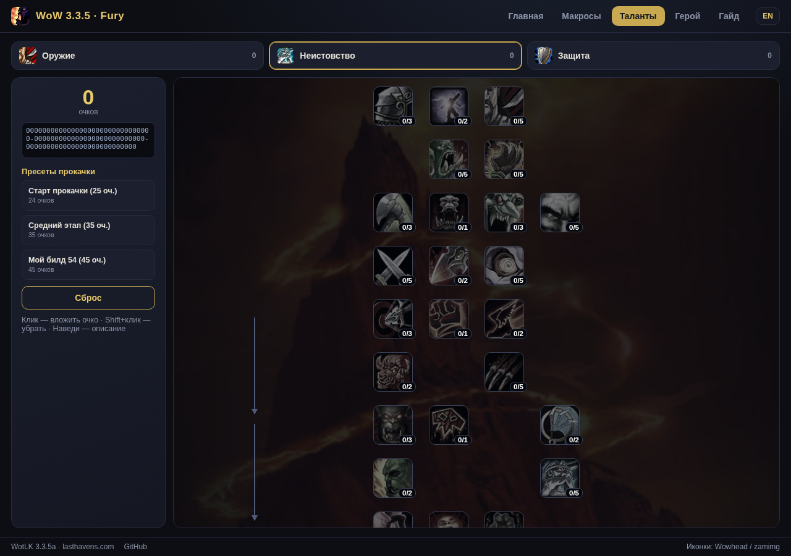
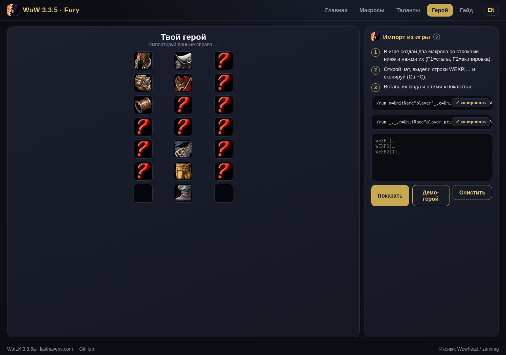
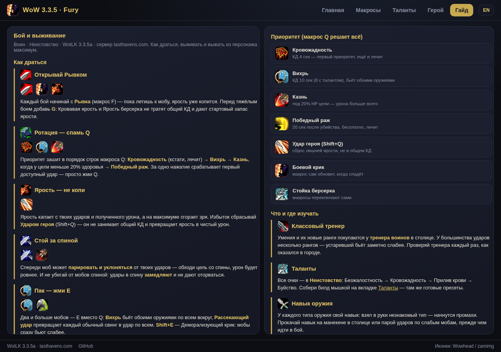

<div align="center">



# WoW 3.3.5 · Умные макросы воина-неистовства

**Пять кнопок вместо пятнадцати: макрос сам выбирает умение под ситуацию, сам
переключает стойку и не обновляет активные баффы. Плюс сайт-приложение:
просмотрщик талантов как в игре, импорт героя без аддонов и гайд
по бою и выживанию.**

[](https://genocide12.github.io/wow-335-macros/)
[](https://lasthavens.com/)
[](macros/warrior-smart/ru/)
[](LICENSE)

**[▶ ОТКРЫТЬ САЙТ](https://genocide12.github.io/wow-335-macros/)** ·
**[Макросы](https://genocide12.github.io/wow-335-macros/macros.html)** ·
**[Таланты](https://genocide12.github.io/wow-335-macros/talents.html)** ·
**[Герой](https://genocide12.github.io/wow-335-macros/hero.html)** ·
**[Гайд](https://genocide12.github.io/wow-335-macros/guide.html)**

**English? → [README.en.md](README.en.md)**

</div>

---

## Что это

Набор из **5 умных макросов** для воина (Неистовство) под WotLK 3.3.5a
и браузерный сервер [lasthavens.com](https://lasthavens.com/). Каждый макрос сам
решает, какое умение нажать: приоритеты ротации зашиты в порядок `/cast`,
стойки переключаются по условию, Боевой крик обновляется только когда спал.

Проверено в бою: **233 DPS** в храме Атал'Хаккар (экипировка ilvl 51, gearscore 537).

```
Q → ротация (одна цель)     E → AoE (2+ моба)      R → сбить каст (по наведению)
F → рывок/перехват          G → ярость + бурст
```

## Сайт — как приложение

Пять экранов, каждый помещается **без прокрутки** на ПК и телефоне:

| Главная | Макросы |
|:---:|:---:|
|  |  |

| Таланты (билды) | Герой (импорт) | Гайд |
|:---:|:---:|:---:|
|  |  |  |

* **Макросы** — карточки с настоящими иконками умений, копирование в один клик
  и фичи каждого макроса прямо в карточке.
* **Таланты** — все 85 талантов воина в трёх ветках, как в игре: иконки, ранги,
  стрелки зависимостей, проверка требований. Клик — вложить очко,
  Shift+клик — убрать. Пресеты прокачки и мой билд 54-го уровня.
* **Герой** — импорт персонажа **без аддона**: два коротких `/run`-макроса
  (в lasthavens свои аддоны ставить нельзя) печатают в чат строку `WEXP|…`;
  вставь её на сайт — получишь папердолл с настоящими иконками предметов
  и тултипами, подтягиваемыми живьём с Wowhead.
* **Гайд** — как драться и выживать: ротация, управление яростью, позиционирование,
  выживание и что где изучать, чтобы выжать максимум из персонажа.

## Установка макросов (1 минута)

1. Скачай [`install/macros-cache-ru.txt`](install/macros-cache-ru.txt)
   (для русского клиента; для английского — [`-en.txt`](install/macros-cache-en.txt)).
2. Закрой игру. Положи файл в `WTF/Аккаунт/<имя>/macros-cache.txt`
   (старый файл сохрани — он перезапишется).
3. Зайди в игру, `/macro` → вкладка «Общие» — все 5 макросов готовы.
   Растащи их на Q, E, R, F, G.

Или просто скопируй текст каждого макроса кнопкой ✓ на
[странице макросов](https://genocide12.github.io/wow-335-macros/macros.html)
и вставь в новые макросы в игре.

> **Язык клиента важен.** Макрос 3.3.5 понимает только названия умений на языке
> клиента. `ru/` — русский клиент, `en/` — английский.

## Как работают умные макросы

| Макрос | Что делает сам |
|---|---|
| **Q · Ротация** | Кровожадность → Вихрь → Казнь (<20% HP) → Победный раж; Боевой крик обновится, только если спал; Shift — Удар героя (сброс ярости), Ctrl — Кровавая ярость |
| **E · AoE** | Вихрь + Рассекающий удар каждый свинг; Shift — Деморализующий крик |
| **R · Сбить каст** | Зуботычина по цели **под курсором** — цель не переключается; сам встанет в стойку берсерка |
| **F · Рывок/Перехват** | Вне боя — Боевая стойка + Рывок, в бою — стойка берсерка + Перехват |
| **G · Ярость** | Кровавая ярость + Ярость берсерка (обе без GCD); Shift — Безрассудство + тринкет |

Механика 3.3.5: за одно нажатие срабатывает **первый доступный** навык списка,
поэтому порядок строк = порядок приоритетов. Спамь Q — ротация исполняется сама.

## Структура

```
docs/               сайт (GitHub Pages)
  index.html        главная
  macros.html       макросы: иконки, копирование, фичи каждого макроса
  talents.html      просмотрщик талантов (85 талантов, 3 ветки, пресеты)
  hero.html         импорт героя из игры (WEXP), папердолл, тултипы Wowhead
  guide.html        гайд: бой, выживание, что и где изучать
  assets/js/macros-data.js  тексты макросов (встроены в сайт, без fetch)
  assets/           фоны веток, данные талантов, логотип (иконки — с CDN Wowhead)
macros/warrior-smart/{ru,en}/   5 макросов + 2 экспортных, RU и EN клиенты
install/macros-cache-{ru,en}.txt  установка в один файл
```

Иконки умений и предметов подключаются напрямую с [CDN Wowhead (zamimg)](https://wow.zamimg.com) —
в репозитории они не хранятся. Живые тултипы предметов подтягиваются
с Wowhead на лету.

## Лицензия

[MIT](LICENSE). Иконки и данные — © Blizzard Entertainment, собраны через открытые
API Wowhead/zamimg.
